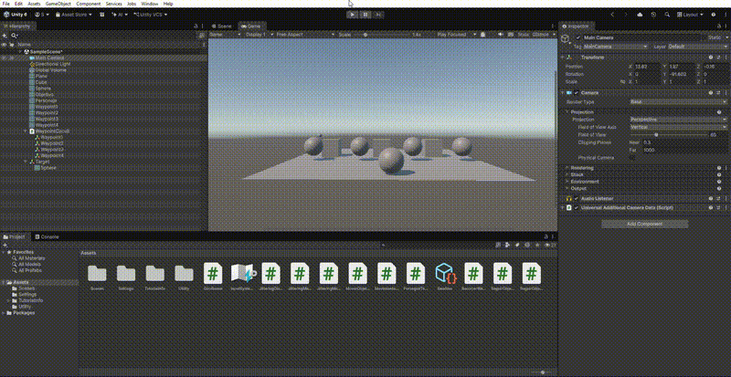

 Práctica 10: Sistema de Waypoints de Unity

 Objetivo

En esta práctica se utiliza el sistema de Waypoints de Unity para crear un circuito por el que se desplaza un objetivo, mientras el personaje lo persigue.

 Desarrollo

Primero se importó la carpeta `Utility` al proyecto para disponer de los componentes necesarios para trabajar con el sistema de Waypoints.

Después, se creó un objeto vacío llamado `WaypointCircuit`, al que se añadió el componente `WaypointCircuit`.

Se crearon cuatro objetos vacíos como hijos del circuito, que representan los puntos del recorrido. Mediante la opción `Assign using all child objects`, se asignaron automáticamente los puntos al circuito.

También se activó la opción `Smooth Route` para conseguir un recorrido curvo y se creó un objeto auxiliar llamado `Target`, independiente del personaje.

A continuación, se añadió el componente `WaypointProgressTracker` al personaje y se asignaron las referencias del circuito y del Target.

Por último, se creó el script `PerseguirTarget.cs`, que permite al personaje perseguir el objetivo mediante:

- `Vector3`: para calcular la dirección hacia el objetivo.
- `Quaternion.LookRotation`: para orientar el personaje hacia él.
- `Quaternion.Slerp`: para realizar un giro suave.
- `Vector3.MoveTowards`: para acercar el personaje al objetivo.
- `Time.deltaTime`: para mantener un movimiento independiente de los fotogramas por segundo.

 Resultado

El objetivo avanza por el circuito mediante el sistema de Waypoints y el personaje lo persigue, recorriendo también la ruta.

 Conclusión

Con esta práctica he aprendido a utilizar el sistema de Waypoints de Unity, configurar un circuito mediante objetos hijos y utilizar `WaypointProgressTracker` para controlar el avance de un objetivo. También he reforzado los conocimientos de movimiento y rotación de prácticas anteriores.