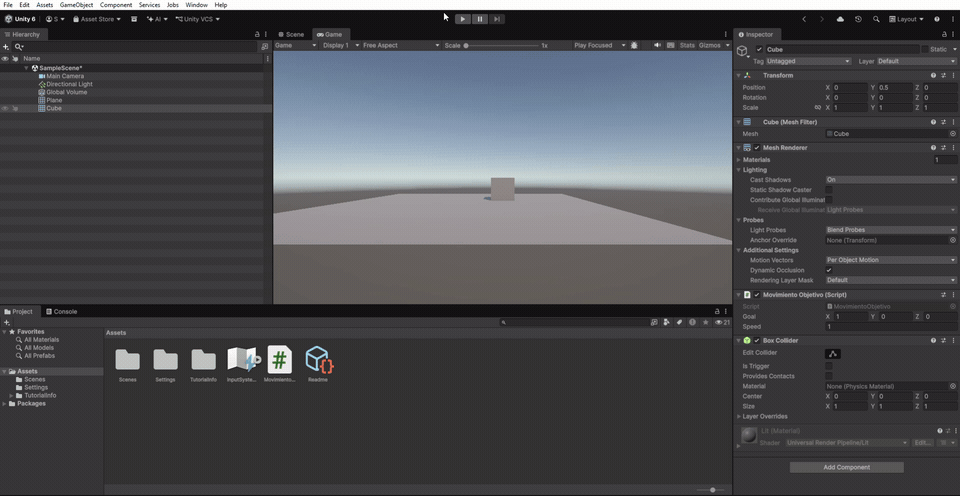

 Práctica 2: Movimiento normalizado y Time.deltaTime

 Objetivo

Conseguir un movimiento consistente del personaje mediante la normalización de vectores, el control de velocidad y el uso de `Time.deltaTime`.

 1. Normalización del vector

Se utiliza `goal.normalized` para mantener la dirección del movimiento sin que la longitud del vector afecte al desplazamiento.

```csharp
this.transform.Translate(goal.normalized);
```

Se realizaron pruebas con los vectores `(1, 0, 0)` y `(5, 0, 0)`, comprobando que ambos producen el mismo desplazamiento por actualización.

 2. Control de velocidad

Se añade una variable pública `speed` para controlar la rapidez del movimiento.

```csharp
public float speed = 0.1f;

this.transform.Translate(goal.normalized * speed);
```

Se probaron diferentes velocidades, como `1` y `5`, para observar cómo cambia la rapidez del objeto.

 3. Uso de Time.deltaTime

Para conseguir un movimiento independiente de la frecuencia de actualización del juego, se multiplica el desplazamiento por `Time.deltaTime`.

```csharp
this.transform.Translate(goal.normalized * speed * Time.deltaTime);
```

`Time.deltaTime` representa el tiempo transcurrido desde el último fotograma. De esta forma, el movimiento depende del tiempo y no del número de fotogramas por segundo.

 Código final

```csharp
using UnityEngine;

public class MovimientoObjetivo : MonoBehaviour
{
    public Vector3 goal;
    public float speed = 0.1f;

    void Update()
    {
        this.transform.Translate(goal.normalized * speed * Time.deltaTime);
    }
}
```

 Demostración

