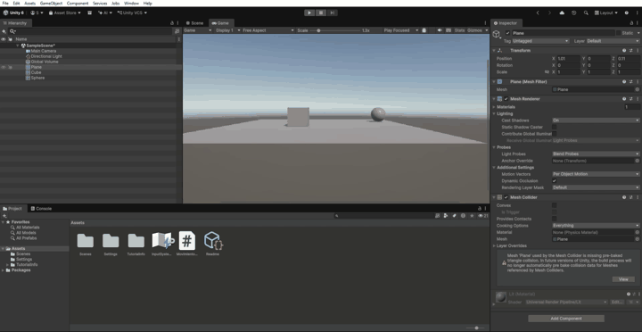

 Práctica 3: Movimiento hacia un objetivo

 Objetivo
En esta práctica hemos modificado el movimiento del objeto para que se desplace hacia la posición de otro objeto de la escena.

 Desarrollo

Primero, hemos creado una esfera llamada `Objetivo` y la hemos colocado en la escena. Después, hemos añadido una variable de tipo `Transform` para poder utilizar su posición como destino.

También hemos utilizado `LookAt()` para que el cubo mire hacia el objetivo antes de comenzar a moverse.

Para calcular el movimiento, restamos la posición del cubo a la posición del objetivo. Después normalizamos esa dirección y utilizamos `Time.deltaTime` para conseguir un movimiento independiente de la velocidad de los fotogramas.

Como la dirección se calcula en coordenadas del mundo, utilizamos `Space.World` para que el movimiento siga esa dirección correctamente.

 Código utilizado

```csharp
using UnityEngine;

public class MovimientoObjetivo : MonoBehaviour
{
    public Transform goal;
    public float speed = 1.0f;

    void Start()
    {
        this.transform.LookAt(goal.position);
    }

    void Update()
    {
        Vector3 direction = goal.position - this.transform.position;
        this.transform.Translate(direction.normalized * speed * Time.deltaTime, Space.World);
    }
}
```

 Resultado

El cubo gira para mirar hacia la esfera y se desplaza en su dirección. Al cambiar la posición de la esfera, el cubo se mueve hacia su nueva ubicación.

