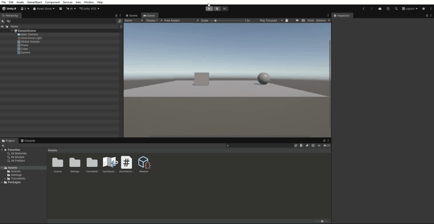

 Práctica 4: Depuración con Debug.DrawRay

 Objetivo

En esta práctica hemos añadido una herramienta de depuración para visualizar la dirección hacia la que se mueve el cubo.

 Desarrollo

Hemos utilizado `Debug.DrawRay()` para dibujar un rayo rojo desde la posición del cubo en dirección al objetivo.

Esta herramienta nos permite comprobar visualmente que la dirección se está calculando correctamente.

Los parámetros utilizados son:

- `this.transform.position`: indica el punto desde el que comienza el rayo.
- `direction`: indica la dirección y longitud del rayo.
- `Color.red`: establece el color rojo.

 Código añadido

```csharp
Debug.DrawRay(this.transform.position, direction, Color.red);
```

Esta línea se añade después de calcular la dirección hacia el objetivo:

```csharp
Vector3 direction = goal.position - this.transform.position;
```

 Resultado

Al ejecutar el proyecto, podemos observar un rayo rojo que sale del cubo y apunta hacia la esfera `Objetivo`. Esto nos permite comprobar que la dirección calculada es correcta.

