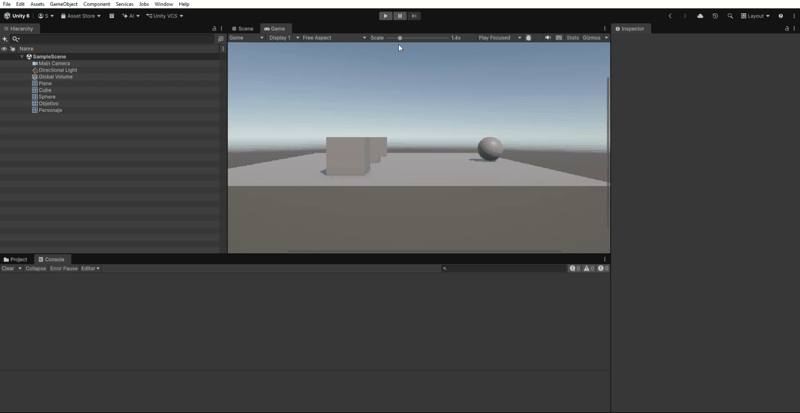
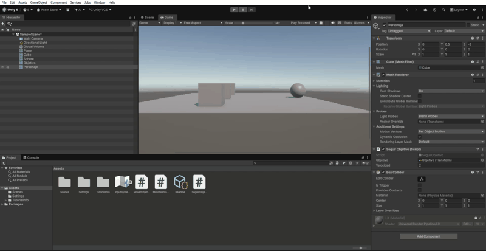

Práctica 5: Seguimiento de un objetivo

 Objetivo

En esta práctica se ha creado un sistema en el que se puede controlar un cubo con las flechas del teclado mientras otro objeto lo persigue continuamente.

 1. Movimiento del objetivo

Se ha creado un cubo llamado `Objetivo`, que se puede mover utilizando las flechas del teclado.

Código utilizado (`MoverObjetivo.cs`):

```csharp
using UnityEngine;

public class MoverObjetivo : MonoBehaviour
{
    public float velocidad = 3f;

    void Update()
    {
        float movimientoHorizontal = Input.GetAxis("Horizontal");
        float movimientoVertical = Input.GetAxis("Vertical");

        Vector3 movimiento = new Vector3(movimientoHorizontal, 0, movimientoVertical);

        transform.Translate(movimiento * velocidad * Time.deltaTime, Space.World);
    }
}
```

 2. Seguimiento del objetivo

Se ha creado otro cubo llamado `Personaje`, que sigue continuamente al cubo `Objetivo` sin utilizar simulación física.

Código utilizado (`SeguirObjetivo.cs`):

```csharp
using UnityEngine;

public class SeguirObjetivo : MonoBehaviour
{
    public Transform objetivo;
    public float velocidad = 2f;

    void Update()
    {
        if (Input.GetKeyDown(KeyCode.Space))
        {
            velocidad += 1f;
        }

        Vector3 direccion = objetivo.position - transform.position;

        transform.position = Vector3.MoveTowards(
            transform.position,
            objetivo.position,
            velocidad * Time.deltaTime
        );
    }
}
```

 3. Configuración de la velocidad

La variable pública `velocidad` permite modificar la velocidad inicial del personaje desde el Inspector de Unity.

Además, cada vez que se pulsa la barra espaciadora, la velocidad aumenta en una unidad.

 4. Resultados

 Movimiento del objetivo



 Seguimiento y aumento de velocidad


