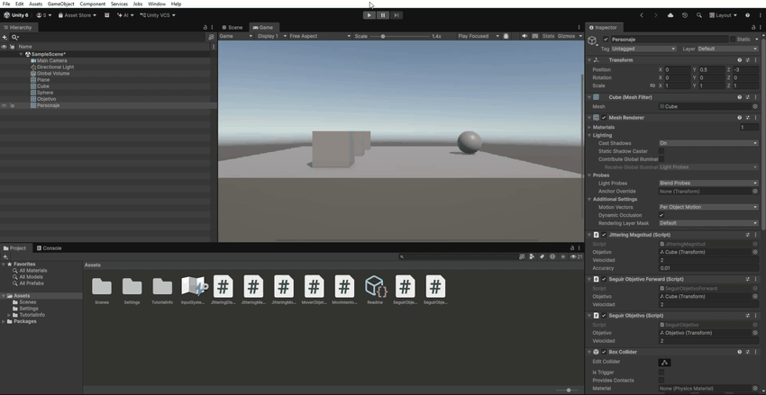
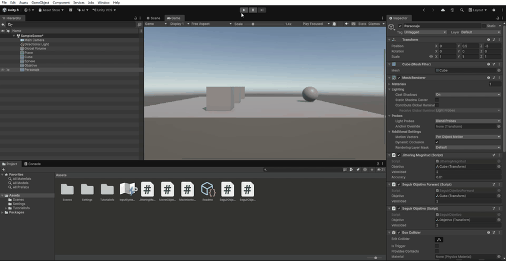

 Práctica 7 – Control del Jittering

 Objetivo

Evitar el jittering (vibraciones) que se produce cuando un personaje intenta alcanzar un objetivo y sobrepasa continuamente su posición.

Para ello, se han implementado tres soluciones diferentes.

## Solución 1: Control mediante la magnitud de la dirección

Se calcula la dirección entre el personaje y el objetivo. El personaje solamente se mueve si la magnitud de esa dirección es superior al valor de `accuracy`.

```csharp
using UnityEngine;

public class JitteringMagnitud : MonoBehaviour
{
    public Transform objetivo;
    public float velocidad = 2f;
    public float accuracy = 0.01f;

    void Update()
    {
        Vector3 direction = objetivo.position - transform.position;

        if (direction.magnitude > accuracy)
        {
            transform.LookAt(objetivo);
            transform.Translate(Vector3.forward * velocidad * Time.deltaTime);
        }
    }
}
```

## Solución 2: Control mediante la distancia

Se utiliza `Vector3.Distance()` para calcular la distancia entre el personaje y el objetivo. El movimiento se realiza solamente cuando la distancia supera el valor de `accuracy`.

```csharp
using UnityEngine;

public class JitteringDistancia : MonoBehaviour
{
    public Transform objetivo;
    public float velocidad = 2f;
    public float accuracy = 0.01f;

    void Update()
    {
        float distancia = Vector3.Distance(transform.position, objetivo.position);

        if (distancia > accuracy)
        {
            transform.LookAt(objetivo);
            transform.Translate(Vector3.forward * velocidad * Time.deltaTime);
        }
    }
}
```

 Solución 3: Uso de MoveTowards

Se utiliza `Vector3.MoveTowards()` para avanzar hacia el objetivo sin sobrepasar su posición, incluso cuando el paso calculado es mayor que la distancia restante.

```csharp
using UnityEngine;

public class JitteringMoveTowards : MonoBehaviour
{
    public Transform objetivo;
    public float velocidad = 2f;

    void Update()
    {
        transform.LookAt(objetivo);

        transform.position = Vector3.MoveTowards(
            transform.position,
            objetivo.position,
            velocidad * Time.deltaTime
        );
    }
}
```

 Resultado

Las tres soluciones permiten controlar el movimiento del personaje hacia el objetivo. La tercera utiliza `MoveTowards()` para evitar que el personaje sobrepase el destino.

 Demostraciones

**Primera grabación:**



**Segunda grabación:**

