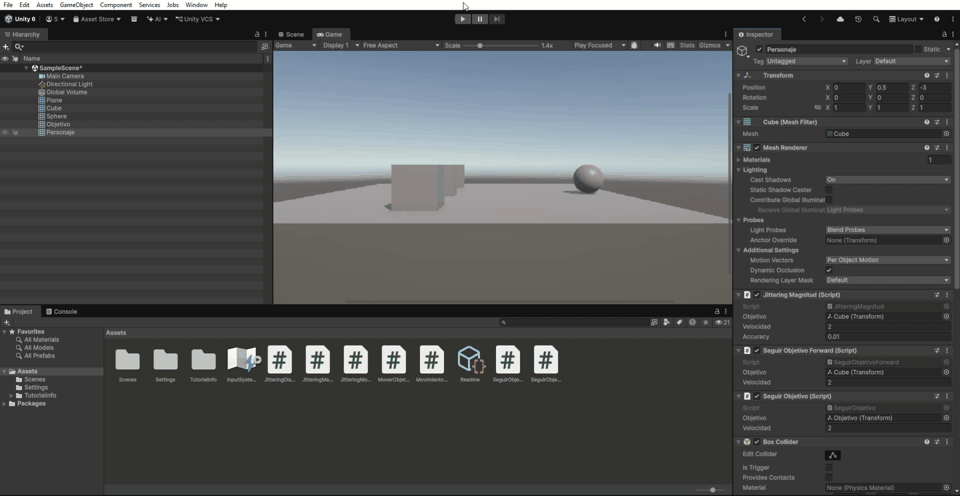

 Práctica 8: Giro suave hacia un objetivo

 Objetivo

En esta práctica se mejora el movimiento rectilíneo hacia un objetivo mediante una rotación progresiva.

Anteriormente se utilizo `transform.LookAt(objetivo)`, que hacía que el personaje girase instantáneamente hacia el objetivo. Para evitar esos cambios bruscos, se utilizo `Quaternion.Slerp`, que permite interpolar suavemente entre la rotación actual y la rotación deseada.

 Código utilizado

```csharp
using UnityEngine;

public class GiroSuave : MonoBehaviour
{
    public Transform objetivo;
    public float velocidad = 2f;

    void Update()
    {
        Vector3 direccion = objetivo.position - transform.position;

        Quaternion rotacionObjetivo = Quaternion.LookRotation(direccion);

        transform.rotation = Quaternion.Slerp(
            transform.rotation,
            rotacionObjetivo,
            velocidad * Time.deltaTime
        );

        transform.Translate(Vector3.forward * velocidad * Time.deltaTime);
    }
}
```

 Explicación

- **Vector3 direccion:** calcula la dirección desde el personaje hasta el objetivo.
- **Quaternion.LookRotation:** calcula la rotación necesaria para mirar hacia el objetivo.
- **Quaternion.Slerp:** realiza una transición suave entre la rotación actual y la deseada.
- **transform.Translate:** permite que el personaje avance hacia delante.
- **Time.deltaTime:** hace que el movimiento sea independiente de la tasa de fotogramas.

Los quaternions facilitan los cálculos de rotación y ayudan a evitar problemas como el Gimbal Lock.

 Resultado de la ejecución


