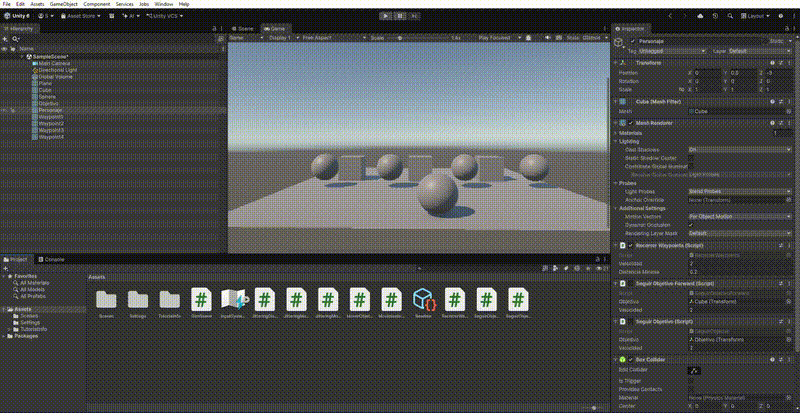

 Práctica 9: Recorrido de Waypoints

 Objetivo

En esta práctica se desarrolla un sistema básico de recorrido mediante Waypoints. El personaje debe desplazarse automáticamente por una serie de puntos colocados en la escena, siguiendo un circuito cerrado.

 Desarrollo

Primero se crearon cuatro esferas en la escena, que representan los Waypoints. A cada una se le asignó la etiqueta `waypoint`.

Después, se creó el script `RecorrerWaypoints.cs`, encargado de controlar el movimiento del personaje.

El funcionamiento del script se basa en los siguientes pasos:

1. **Buscar los Waypoints:** mediante `GameObject.FindGameObjectsWithTag("waypoint")` se localizan todos los objetos que tienen esa etiqueta.
2. **Ordenar los objetivos:** se utiliza `Array.Sort` para organizar los Waypoints por nombre.
3. **Calcular la dirección:** se resta la posición del personaje a la posición del objetivo para obtener la dirección hacia la que debe avanzar.
4. **Girar hacia el objetivo:** se utilizan `Quaternion.LookRotation` y `Quaternion.Slerp` para conseguir un giro suave.
5. **Desplazarse:** se utiliza `Vector3.MoveTowards` para acercar el personaje al objetivo sin sobrepasarlo.
6. **Cambiar de objetivo:** cuando el personaje alcanza un Waypoint, pasa al siguiente. Al llegar al último, vuelve al primero y repite el circuito.

 Resultado

El personaje recorre automáticamente los cuatro Waypoints siguiendo un circuito cerrado.

 Conclusión

Con esta práctica he aprendido a utilizar etiquetas para localizar objetos, organizar una colección de objetivos y gestionar el desplazamiento de un personaje entre diferentes posiciones. También he aplicado conceptos de rotación y movimiento trabajados en prácticas anteriores.