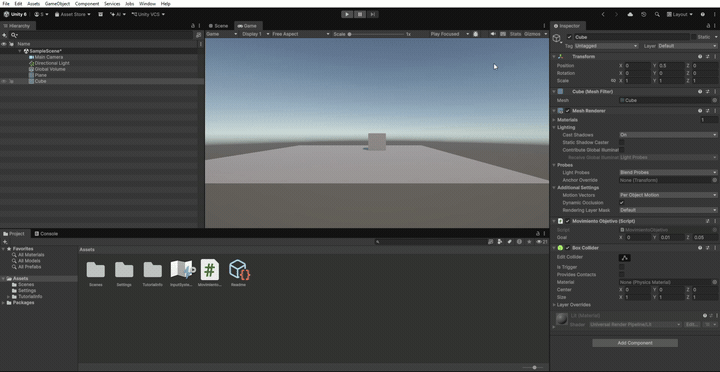

 Práctica 1 – Movimiento mediante Transform.Translate

 1. Objetivo de la práctica

El objetivo de esta práctica es aprender a mover objetos en Unity utilizando el método `Translate()` de la clase `Transform`, trabajando con coordenadas X, Y y Z.

También se estudia cómo cambia el movimiento al modificar una variable de tipo `Vector3`.

 2. Desarrollo de la práctica

2.1. Movimiento mediante Start()

Se utiliza `this.transform.Translate(goal);` dentro del método `Start()`.

El objeto se desplaza una única vez cuando comienza la ejecución.

2.2. Movimiento con desplazamientos cada vez más pequeños

Se introduce `Translate(goal)` dentro de `Update()` y se multiplica `goal` por `0.5f`.

El objeto realiza desplazamientos cada vez más pequeños, hasta que prácticamente deja de moverse.

 2.3. Modificación de goal en Start()

Al colocar `goal = goal * 0.5f;` dentro de `Start()`, la variable se reduce a la mitad una sola vez.

El objeto continúa moviéndose con desplazamientos constantes porque `Translate()` se ejecuta en cada actualización.

 2.4. Movimiento con desplazamientos cada vez mayores
Al utilizar `goal = goal * 2.0f;` dentro de `Update()`, el desplazamiento se duplica continuamente.

Como resultado, el objeto se mueve cada vez más lejos y aumenta rápidamente la distancia recorrida en cada actualización.

 2.5. Modificación de la coordenada Y

Se realizan dos pruebas:

- **Y = 0:** el objeto no tiene desplazamiento vertical.
- **Y = 1:** el objeto también se desplaza hacia arriba.

Esto permite comprobar cómo influye cada coordenada del vector `goal` en el movimiento.

 2.6. Despegue y vuelo

Finalmente, se modifica el valor de `goal` para conseguir que el objeto avance y se eleve al mismo tiempo.

Se utilizan los siguientes valores:

- X = 0
- Y = 0.01
- Z = 0.05

El objeto asciende progresivamente mientras avanza, simulando el despegue y vuelo de un avión.

3. Código final del vuelo

```csharp
using UnityEngine;

public class MovimientoObjetivo : MonoBehaviour
{
    public Vector3 goal;

    void Update()
    {
        this.transform.Translate(goal);
    }
}
```

 4. Resultado de la práctica

Se han realizado todos los experimentos solicitados y se ha comprobado cómo los cambios en la variable `goal` afectan al desplazamiento del objeto.

 5. GIF de ejecución


